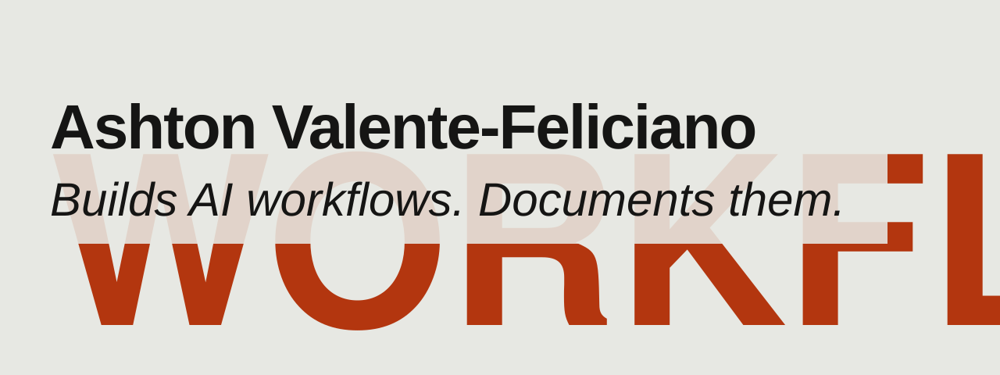

I build practical AI workflows using n8n, Claude Code skills and MCP connectors, and I run them on my own server. I started working with these tools in 2025, bringing together automation, hands-on technical work and a knack for making complex systems easier to use.

Before that, I spent four years creating and checking technical documentation for U.S. Coast Guard systems. The work included maintenance procedures, reliability analyses and requirements lists - all focused on helping people maintain equipment accurately and consistently.

My background also includes four years in air cargo logistics, where I reached journeyman level and supervised teams of up to six. Earlier in my career, I trained in electrical work and repaired shipboard power systems, including 400 Hz motor-generators. I completed an 8,000-hour registered electrical maintenance apprenticeship and earned a degree in technical studies focused on electronic instrumentation.

I’m a Navy and Air Force veteran.

## Work you can check

| Project | What it shows | Evidence |
|---|---|---|
| [ai-automation-lab](https://github.com/avf-works/ai-automation-lab) | n8n job-search pipeline: 10+ job sources, deduplication, LLM ranking, contact lookup, Telegram delivery, and a designed 35-test evaluation suite. Morning brief that reads Gmail through OAuth. Stack: LiteLLM and Ollama model routing, Docker on a Linux VPS, Twingate zero-trust access | Build log and stack table in the README |
| [odysseus (fork)](https://github.com/ashtonfeliciano/odysseus) | Self-hosted AI workspace: upstream catch-up merges, Google Drive MCP for admins, a guardrail module that adds knowledge-base rules to the assistant's system prompt, and a Docker Compose file for a VPS | Merged PRs 1 to 4, `src/ckb_guardrails.py`, `docker-compose.vps.yml` |
| [advanced-flex-sorting-obsidian-headers](https://github.com/ashtonfeliciano/advanced-flex-sorting-obsidian-headers) | CSS snippet that groups and orders Obsidian folders with attribute selectors and flexbox | Step-by-step screenshots |
| [MyOpenSwarm (fork)](https://github.com/ashtonfeliciano/MyOpenSwarm) | Multi-agent OpenSwarm setup for a VPS | Fork notes |

## Skill areas

| Skill | Where it shows |
|---|---|
| n8n pipelines, scheduled jobs, Gmail and Telegram APIs | ai-automation-lab |
| LLM ranking and model routing (LiteLLM, Ollama) | ai-automation-lab |
| Evaluation: a designed 35-test suite | ai-automation-lab |
| MCP connectors | odysseus, Google Drive MCP (PR 4) |
| System-prompt guardrails | odysseus, `src/ckb_guardrails.py` |
| Docker, Docker Compose, Linux VPS, zero-trust remote access | odysseus `docker-compose.vps.yml`, ai-automation-lab stack table |
| CSS attribute selectors and flexbox | advanced-flex-sorting-obsidian-headers |

## Contact

[LinkedIn: linkedin.com/in/ashtonavf](https://www.linkedin.com/in/ashtonavf)
